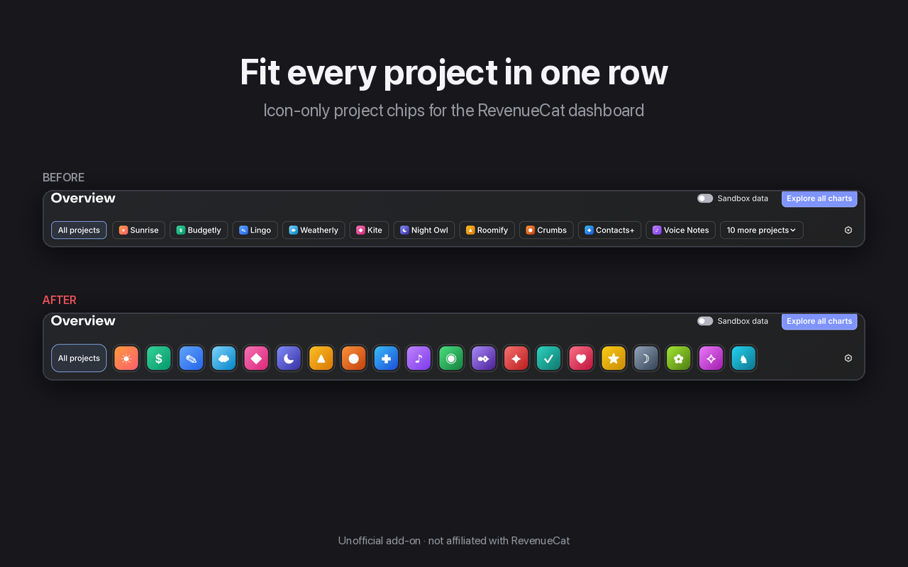

# RC Extras

Unofficial Chrome extension for the [RevenueCat](https://www.revenuecat.com) dashboard: every project in one row.

| Feature | What it does |
|---|---|
| Every project in one row | Overview filter chips show just the app icon (hover for the name); size slider 16–44 px |
| More transactions | "Load more" under the All projects transactions table (RevenueCat stops at 20) |
| Renews or expires | Capsule after each future expiry date in transactions: ✓ renews, ✕ expires, ! billing issue, ✓ converts (trials) |
| Trial end dates | End date under "Trialing" in customer lists |
| Running totals | Σ on Revenue/Proceeds, New Customers and Active Customers cards, per card |
| Your period | 7–365 days per card for Revenue/Proceeds and New Customers |
| Your currency | Currency picker on the Revenue card; every $ amount converts (30 currencies, daily ECB rates) |
| Gross or net | Default revenue type (Revenue, net of taxes, Proceeds) applied on every load |
| Automatic icons | Letter-only projects get their Web Billing icon or website favicon |
| Synced projects | RevenueCat's project order, hidden and default project, across your Chrome profiles |

Site: https://rcextras.akro-in.si · Privacy: https://rcextras.akro-in.si/privacy

## Install

- [Chrome Web Store](https://chromewebstore.google.com/detail/rc-extras/ahikobcaeofngodbkpofipmlhmeippif)
- From source: `chrome://extensions` → Developer mode → **Load unpacked** → `extension/`

## Repo layout

| Path | Contents |
|---|---|
| `extension/` | The extension (MV3, no build step); zip this folder for the Web Store |
| `docs/` | README images |

## How it works

| File | Role |
|---|---|
| `main.js` | Page world, document_start: adjusts RevenueCat's own requests (transactions limit + cursor, chart periods, running totals) and refetches charts in place |
| `content.css` / `content.js` | Icon-only chips (incl. the hidden copies RevenueCat measures), hover titles, live icon size, automatic icons |
| `transactions.js` | "Load more" rows, cloned from RevenueCat's own rows |
| `trials.js` | Renews/expires capsules in transactions; trial end dates in customer lists |
| `currency.js` | Currency conversion + picker, default revenue type |
| `overview.js` | Σ and period controls on the Overview cards |
| `sync.js` | Project order sync; hands chart settings to `main.js` early |
| `background.js` | Favicons and exchange rates, returned as data (the dashboard's CSP blocks other hosts) |

Everything reads only what your dashboard already shows, with your own session.

RevenueCat can change its dashboard at any time; if something breaks, please [open an issue](https://github.com/rokgregoric/rcextras/issues/new/choose).

## Feature requests

[Request a feature](https://github.com/rokgregoric/rcextras/issues/new?template=feature_request.yml) on GitHub.

## License

[MIT](LICENSE). Not affiliated with, endorsed by or sponsored by RevenueCat, Inc. "RevenueCat" is a trademark of RevenueCat, Inc.
